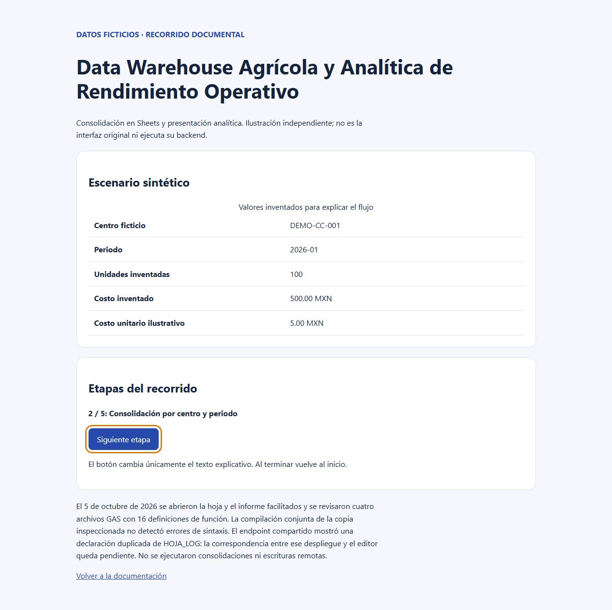

# Data Warehouse Agrícola y Analítica de Rendimiento Operativo

Consolidación en Sheets y presentación analítica.

**Estado:** caso de estudio documental de fuentes GAS y Sheets consultadas en lectura. El código operativo y sus datos no se distribuyen en este repositorio. Se publican documentación nueva y un recorrido ilustrativo con datos ficticios.

## Problema y solución

Organizar registros de trabajo, catálogos y movimientos operativos para su consulta analítica, manteniendo coherencia temporal y trazabilidad.

El GAS ligado a la hoja revisada contiene módulos de consolidación, autocompletado, depuración y registro de eventos. El solicitante reporta consultas SQL en BigQuery conectadas a Looker Studio; la definición de esas consultas no se inspeccionó.

## Funciones observadas en la fuente

- Consolidación de registros de trabajo y transacciones adicionales definida en la fuente.
- Procesamiento de fletes y referencias de catálogos.
- Autocompletado y validación de entradas por área y actividad.
- Depuración de duplicados y utilidades de registro de eventos.
- Informe Looker Studio accesible; conexión BigQuery reportada por el solicitante.

## Tecnologías verificadas

Google Apps Script, Google Sheets y Looker Studio fueron observados. El solicitante confirma BigQuery y consultas SQL como parte del flujo; sus conexiones y consultas quedan pendientes de inspección. Consulte la [arquitectura](docs/architecture.md).

## Evidencia y resultados

El 5 de octubre de 2026 se abrieron la hoja y el informe facilitados y se revisaron cuatro archivos GAS con 16 definiciones de función. La compilación conjunta de la copia inspeccionada no detectó errores de sintaxis. El endpoint compartido mostró una declaración duplicada de HOJA_LOG: la correspondencia entre ese despliegue y el editor queda pendiente. No se ejecutaron consolidaciones ni escrituras remotas.

No se publican métricas de ahorro, adopción o productividad. La [verificación](docs/verification.md) explica su alcance. La aportación personal detallada y la autoría integral del código operativo no están acreditadas públicamente; este caso presenta la revisión técnica y la documentación del proyecto asociado al portafolio.

## Demostración y capturas

Abra [demo/index.html](demo/index.html) localmente. El recorrido funciona sin servidor, instalación ni conexión a servicios. Su tabla representa [datos sintéticos](examples/scenario.json), no una captura de la aplicación original. El botón recorre textos ilustrativos; no ejecuta operaciones de negocio.

Puede verificar los datos usando Python 3: `python examples/verify.py`.

El [modelo SQL sintético](examples/model.sql) se ejecuta en SQLite en memoria. Comprueba agregación antes del cruce, producción cero, costos o producción ausentes y rechazo de claves repetidas. Es un ejemplo pedagógico independiente, no una exportación de BigQuery ni una réplica del modelo real.

## Caso de estudio

Consulte [problema, decisiones y aprendizajes](docs/case-study.md).

## Seguridad y limitaciones

Publicación independiente sin historial operativo. No incluye credenciales, identificadores de servicios, catálogos empresariales, datos personales, archivos de respaldo ni configuración productiva. Las pruebas de la fuente se ejecutaron con simulación o temporales aislados; el recorrido público es una explicación independiente.

## Pendientes

- Resolver la declaración duplicada de HOJA_LOG y comprobar la versión desplegada en una fase técnica.
- Verificar consultas SQL, conexión BigQuery, linaje y definiciones de indicadores.
- Validar consolidación, duplicados y recuperación sobre una copia con datos ficticios.
- Acreditar modelo dimensional, latencia y resultados operativos antes de afirmarlos.
- Confirmar responsabilidades históricas y decidir licencia.

## Licencia

Pendiente de decisión expresa. No se asigna una licencia de software ni se atribuyen derechos sobre el código operativo.
