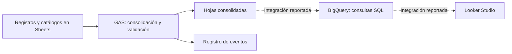

# Arquitectura revisada

Fecha: 2026-10-05. Diagrama del alcance observado, con nombres de componentes genéricos.

## Componentes y responsabilidades

- Consolidación de registros de trabajo y transacciones adicionales definida en la fuente.
- Procesamiento de fletes y referencias de catálogos.
- Autocompletado y validación de entradas por área y actividad.
- Depuración de duplicados y utilidades de registro de eventos.
- Informe Looker Studio accesible; conexión BigQuery reportada por el solicitante.

## Arquitectura del repositorio público

Este repositorio contiene Markdown, un JSON sintético, un verificador Python de biblioteca estándar y un recorrido HTML autónomo. No contiene backend, servicios externos ni réplica del sistema operativo. El diagrama anterior describe la fuente local revisada.

## Límites

- Resolver la declaración duplicada de HOJA_LOG y comprobar la versión desplegada en una fase técnica.
- Verificar consultas SQL, conexión BigQuery, linaje y definiciones de indicadores.
- Validar consolidación, duplicados y recuperación sobre una copia con datos ficticios.
- Acreditar modelo dimensional, latencia y resultados operativos antes de afirmarlos.
- Definición de licencia en su fase técnica propia.
