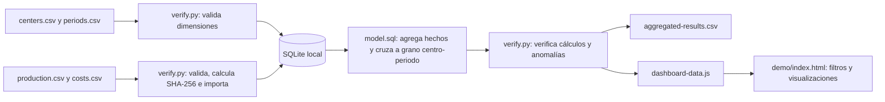

# Arquitectura del ejemplo público

Fecha: 2026-10-09. Este diagrama describe solo el ejemplo sintético reproducible del repositorio.

## Componentes

- **CSV:** dimensiones y hechos completamente ficticios con claves `DEMO-`.
- **Python:** biblioteca estándar; valida encabezados, tipos, identificadores, referencias y reimportación.
- **SQLite:** claves primarias, claves foráneas, transacciones, manifiesto de huellas y consulta agregada.
- **Exportación:** CSV para inspección y JavaScript local generado desde las mismas filas para el dashboard sin conexión.
- **Dashboard:** lee `dashboard-data.js`; filtros y tendencias operan sobre esa salida local. No usa API ni servicio externo.

El costo se guarda como centavos enteros. La consulta agrega producción y costos de forma independiente antes de unirlos. El scaffold con centros y periodos conserva combinaciones con datos faltantes. Ver [diccionario de datos](data-dictionary.md) para fórmulas y manejo de valores nulos.

## Límites de la arquitectura real

La revisión local histórica describió componentes de Google Apps Script, Sheets y un informe de Looker Studio. La integración BigQuery se reportó, pero no se verificó en esta revisión. Acceso actual a la hoja, conexión, consultas, linaje, captura de interfaz real y versión desplegada quedan pendientes. El ejemplo SQLite no replica ni demuestra esos componentes.
